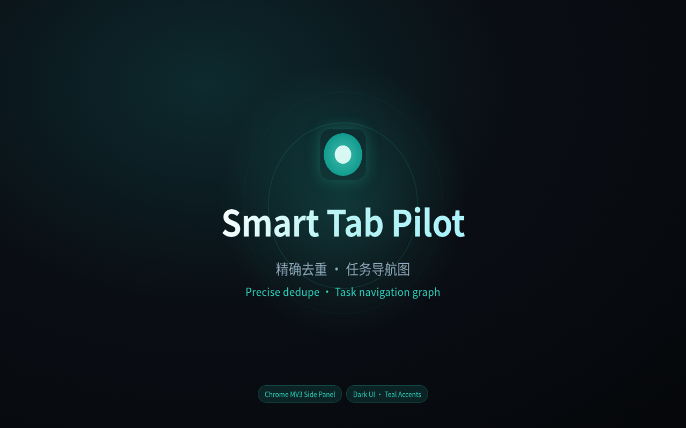
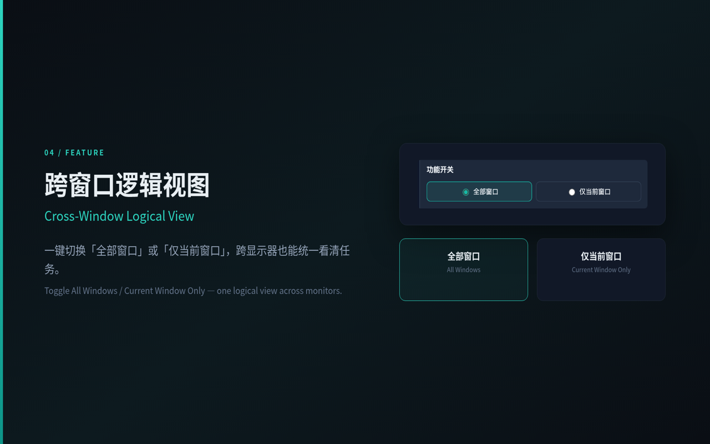
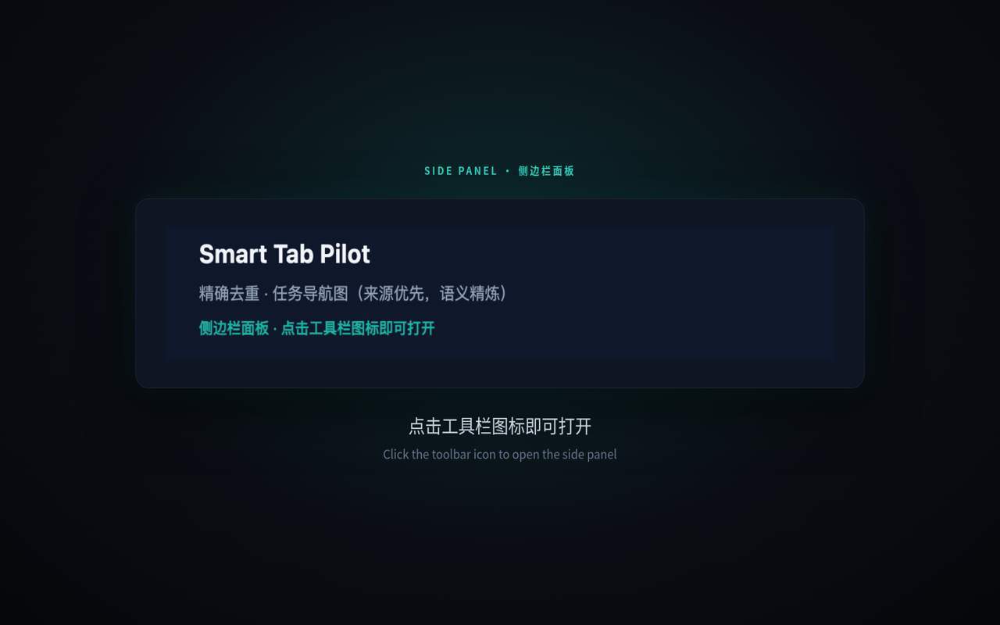

# Smart Tab Pilot

[](./LICENSE)
[](./manifest.json)
[](#install)
[](./manifest.json)

**Exact URL dedupe with cross-window jump**, plus a **task navigation graph** that groups tabs by how you actually navigated — not by hostname. The UI lives in Chrome’s **side panel**. Naming and mixed-cluster refinement prefer on-device Gemini Nano, then a custom OpenAI-compatible endpoint, then local heuristics.

中文：跨窗口精确 URL 去重跳转，再用任务导航图按来源 / 时间归组（语义只负责精炼与命名）。侧边栏操作；模型顺序为 Nano → 自定义 OpenAI 兼容接口 → 启发式。

Chrome Web Store listing is **under review** (coming soon). Until then, load the unpacked source from this repository. Privacy policy: [https://biubiuhu.github.io/smart-tab-pilot/chrome-web-store/privacy.html](https://biubiuhu.github.io/smart-tab-pilot/chrome-web-store/privacy.html).

Pure front-end JavaScript — no build step. License: [MIT](./LICENSE).

## Promo

Watch the ~28s product tour on the [GitHub Pages homepage](https://biubiuhu.github.io/smart-tab-pilot/#promo) (HTML5 player). Light tech BGM; press play to hear it (no autoplay). GitHub’s README cannot play `<video>` inline — click the poster, or open the [hosted file](https://biubiuhu.github.io/smart-tab-pilot/assets/promo.mp4).

中文：约 28 秒产品介绍（精确去重 · 任务导航图 · 侧边栏），含轻科技背景乐。商店即将上线，没有 YouTube 镜像。

<p align="center">
  <a href="https://biubiuhu.github.io/smart-tab-pilot/#promo">
    
  </a>
</p>

## Features

- **Exact URL dedupe** — If any window already has the same URL, Smart Tab Pilot focuses that window, activates the existing tab, and closes the duplicate. Default match includes the hash (`ignoreHash` is off). Internal pages (`chrome://`, `chrome-extension://`, `about:`, `edge://`, …) are skipped.
- **Task navigation graph** — Groups by opener tree, `document.referrer`, nearby same-window opens, and learned origin+path priors. Semantics refine names and mixed clusters; **same hostname does not force a merge**. Cross-window work stays one logical task; Chrome `tabGroups` are still written per window.
- **Side panel UI** — Click the toolbar icon (or the shortcut) to fill the browser side panel. There is no action popup.
- **Settings as its own view** — Language, Nano status, custom model fields, and feature toggles live on a separate settings page inside the panel — the task list stays the main surface.
- **Window scope** — Toggle **All windows** / **Current window only**. The choice is saved.
- **Drag-merge & split** — Drag a task card (or a tab) onto another task to merge, or split a tab into its own task. That pair’s learned weight is strengthened.
- **Close whole group** — Close every tab in a logical task, respecting the current window scope.
- **Chinese / English** — Follow the browser, or lock 中文 / English (`uiLocale`).

<p align="center">
  
</p>

## Install

Load unpacked from source (Chrome, developer mode):

1. Open Chrome and go to `chrome://extensions`.
2. Turn on **Developer mode**.
3. Click **Load unpacked**.
4. Choose the **repository root** — the folder that contains `manifest.json` (the directory you cloned, e.g. `smart-tab-pilot/`).
5. Pin the toolbar icon, then **click the icon** (or press Ctrl+Shift+K / ⌘⇧K) to open the side panel.

After you edit source files, click **Reload** on `chrome://extensions`.

Chrome Web Store install will be linked here once the listing is published. The item is currently **in review**.

## Usage

| Action | How |
|--------|-----|
| Open the side panel | Toolbar icon, or **Ctrl+Shift+K** / **⌘⇧K** |
| Rebind the shortcut | `chrome://extensions/shortcuts` |
| Jump to a tab | Click a row in the task view |
| Organize now | **Organize tasks now** (`立即整理任务`) — extract, build the graph, write physical groups per window |
| Merge / split | Drag a task or tab onto another card; or split into its own task |
| Close a logical group | **Close this group** on the card |
| Quick search (optional) | Enable it in Settings, then search open tabs and recently closed ones (↑↓, Enter) |

<p align="center">
  
</p>

## Settings

Settings is a **separate panel view** (gear in the header → back to the task list). Highlights:

- **Language** — Follow browser / 中文 / English.
- **Exact URL dedupe** and **ignore hash** (off = hash is part of the match).
- **Auto-group by task** after a page reaches `complete`.
- **Quick search** — optional, off by default.
- **Gemini Nano (Prompt API)** — status `available` / `downloadable` / `downloading` / `unavailable` / API missing. When downloadable, use **Download / enable Nano** (must be a user gesture; `LanguageModel.create()`).
- **Custom OpenAI-compatible model** — Base URL, API key, and model name in `chrome.storage.sync`. Used for naming and same-project judgment, not for “same domain ⇒ same group”. The endpoint is **yours**; the extension does not ship a vendor backend.

### Gemini Nano / Prompt API notes

- Needs a recent Chrome that exposes the [Prompt API](https://developer.chrome.com/docs/ai/prompt-api) `LanguageModel`.
- Some environments require experiment flags and permission to download the on-device model.
- Availability is checked with the same options as `create` / `prompt`.
- If Nano is unavailable, configure a custom endpoint or rely on heuristics. Grouping still follows the navigation graph.

## Development

No bundler. From the repository root:

```bash
npm test
npm run pack
```

- **Tests** — `node --test tests/*.test.mjs`
- **Pack** — writes `artifacts/smart-tab-pilot-<manifest.version>.zip` (currently `artifacts/smart-tab-pilot-1.5.0.zip`). The zip is MV3 runtime only: `manifest.json`, `background/`, `sidepanel/`, `shared/`, `content/`, `icons/`, `_locales/`, `LICENSE`. It excludes `tests/`, `docs/`, `.git/`, `node_modules/`, `popup/`. If system `zip` is missing, the script falls back to Python or pure Node.

Do not commit zip artifacts. Store listing drafts, permission justifications, and the privacy policy live under `docs/chrome-web-store/`.

Manual checklists:

- [`docs/smart-tab-pilot-mvp/05-testing/manual-checklist.md`](./docs/smart-tab-pilot-mvp/05-testing/manual-checklist.md)
- [`docs/task-graph-cross-window/05-testing/manual-checklist.md`](./docs/task-graph-cross-window/05-testing/manual-checklist.md)

## Documentation

- Product site (GitHub Pages): [https://biubiuhu.github.io/smart-tab-pilot/](https://biubiuhu.github.io/smart-tab-pilot/)
- Product promo (~28s): [watch on Pages](https://biubiuhu.github.io/smart-tab-pilot/#promo) · [promo.mp4](https://biubiuhu.github.io/smart-tab-pilot/assets/promo.mp4)
- Task-graph design: [`docs/task-graph-cross-window/01-product/PRD.md`](./docs/task-graph-cross-window/01-product/PRD.md)
- Store listing drafts (en / zh): [`docs/chrome-web-store/`](./docs/chrome-web-store/)
- Engineering notes (not the public homepage): [`docs/smart-tab-pilot-mvp/`](./docs/smart-tab-pilot-mvp/), [`docs/task-graph-cross-window/`](./docs/task-graph-cross-window/)

## Privacy

Public policy (HTTPS, used for the store listing):

**[https://biubiuhu.github.io/smart-tab-pilot/chrome-web-store/privacy.html](https://biubiuhu.github.io/smart-tab-pilot/chrome-web-store/privacy.html)**

There is no first-party cloud account. Full page bodies are not persisted (title + path/slug + 1–2 sentences only). Network calls leave the device only for on-device Nano or to a **user-configured** Base URL. No analytics or crash telemetry in source.

## License

[MIT](./LICENSE)

---

## Permissions

- `tabs` / `tabGroups` / `scripting` / `storage` / `sessions` / **`sidePanel`**
- `host_permissions`: `<all_urls>` (compact on-page extract for short summaries)
- `side_panel.default_path`: `sidepanel/sidepanel.html`
- `action`: **no** `default_popup`; `setPanelBehavior({ openPanelOnActionClick: true })`
- `commands`: `_execute_action` → Ctrl+Shift+K / ⌘⇧K

## Caveats

- **Service worker sleep** — The MV3 background may suspend; the next event wakes it. The first classify after a long idle can be slightly slow.
- **Restricted pages** — `chrome://` and similar cannot be injected; dedupe and grouping skip them.
- **CSP / sandboxed pages** — A few sites block the content script; the extension may fall back to `scripting.executeScript`.
- **Nano varies by device** — If it is missing, set a custom model or use heuristics.
- **Custom API keys** live in `chrome.storage.sync`. Do not put production secrets on an untrusted profile.
- **Recently closed** — Tabs closed before install come from `chrome.sessions`; later closes are tracked here. Dedupe-closed duplicates are not added to “recently closed”.
- **Shortcut clashes** — If Ctrl/⌘⇧K does nothing, bind it in `chrome://extensions/shortcuts`.
- **No build artifacts** — This repo is plain JS (no `package-lock.json` / bundler).

## Acknowledgments

Compact page-text extraction is inspired by [alibaba/page-agent](https://github.com/alibaba/page-agent): a **textual / dehydrated DOM** (flat tree in `packages/page-controller`) so a cheap text model can understand a page without screenshots.

This extension does **not** vendor the page-agent stack. It only borrows the “text DOM snapshot” idea and implements a small extractor (semantic `article`/`main`, heading outline, strip nav/footer noise, hard character cap) for tab-topic naming.

## Repository layout

```text
manifest.json          MV3 entry
background/            service worker, dedupe, grouping, summaries
sidepanel/             product UI (only surface users open)
shared/                task graph, i18n, storage, URL helpers
content/extract.js     compact text snapshot
_locales/              chrome.i18n + store strings (en, zh_CN)
icons/                 toolbar / store icons
docs/                  GitHub Pages + engineering notes
scripts/               npm run pack
tests/                 node:test
popup/                 unused legacy popup (not in the packed zip)
```

## Side panel reference

| Control | Role |
|---------|------|
| Task view | Logical tasks, window badges, click-to-jump |
| All windows / current | Saved scope for list, organize, and close-group |
| Organize tasks now | Extract + graph + per-window physical groups |
| Drag merge / split | Strengthens that URL-pair’s learned weight |
| Close this group | Closes tabs in the logical task for the current scope |
| Quick search | Open + recently closed; ↑↓ / Enter |
| Settings view | Language, Nano, custom model, feature toggles |
