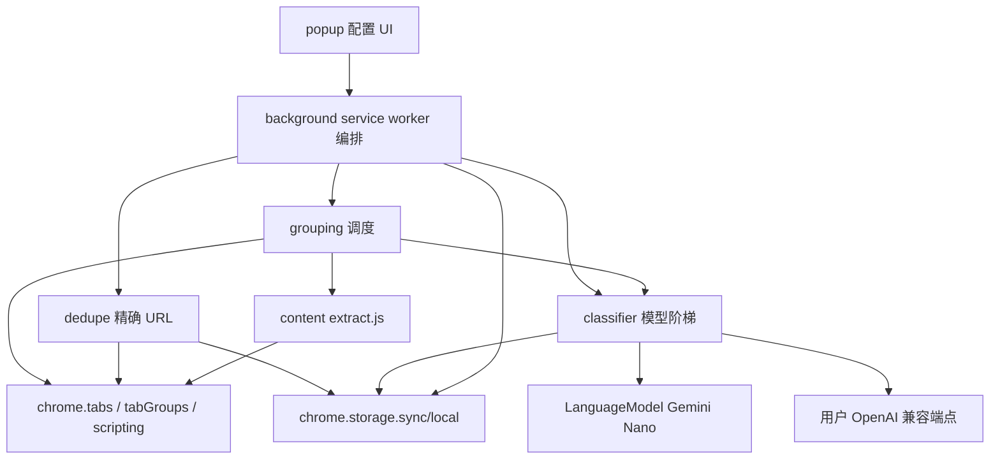
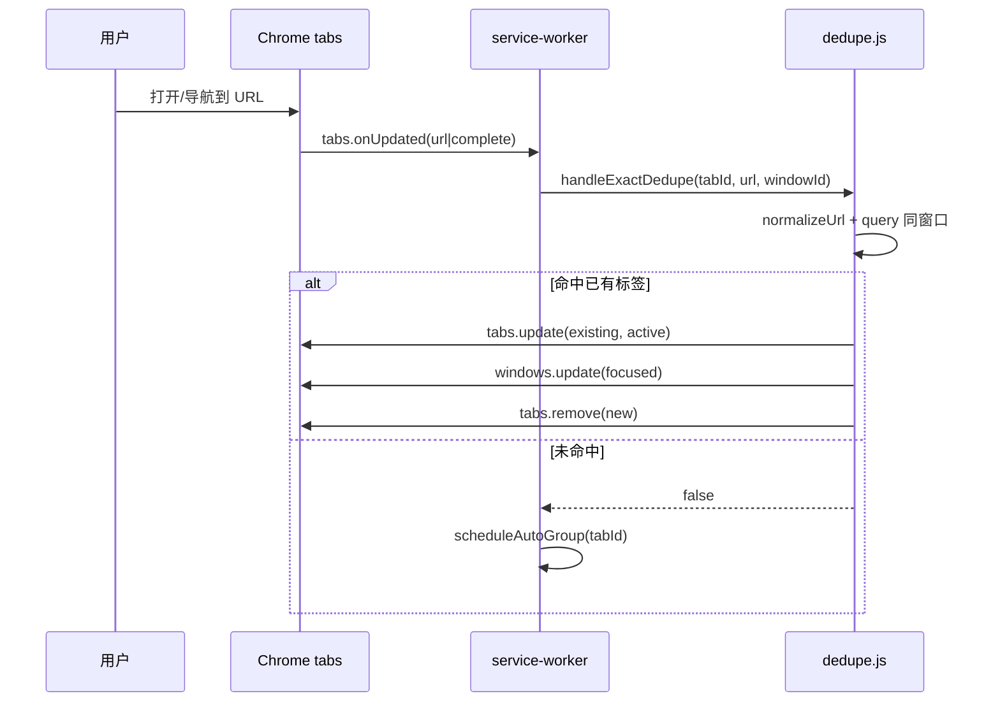
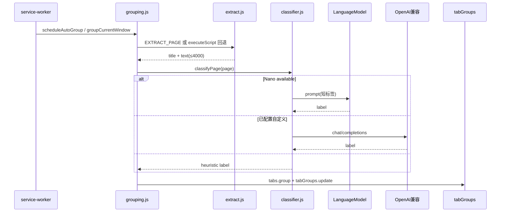

# Smart Tab Pilot 技术架构设计

## 0. 版本历史

| 版本 | 日期 | 变更内容 | 变更原因 | 影响 |
|------|------|----------|----------|------|
| v0.1 | 2026-11-03 | MV3 扩展架构、模型阶梯、抽取边界 | 对齐现有 scaffold 与 MVP PRD | awaiting-user-review |

## 1. 当前决策

- 当前技术决策：
  - Chrome **Manifest V3** 纯前端扩展（ES modules service worker），**无构建步骤**、无自有后端。
  - 编排中心：`background/service-worker.js`。
  - 去重：`background/dedupe.js` + `shared/url-utils.js`。
  - 分组：`background/grouping.js` + `content/extract.js` + `background/classifier.js`。
  - 设置：`shared/storage.js` → `chrome.storage.sync`。
  - 模型阶梯：`LanguageModel`（Nano）→ 用户 OpenAI 兼容 `fetch` → 启发式。
  - 抽取：自研文本 DOM 快照；灵感自 page-agent，**不引入其 npm/源码依赖**。
- 当前自研边界：去重、抽取、分类编排、tabGroups 写入、弹窗；不自研通用 Agent 框架。
- 当前实施边界：manual-gated；本轮只交付文档。现有代码为 scaffold，审核后再按 backlog 收敛/补齐。

## 2. 分层架构

本产品无「网关/主服务」后端。分层按扩展上下文表达，调用方向单向向下：

约束：

- Popup / Content Script **不得**直接打自定义模型 API（统一经 background `classifier`），避免逻辑分叉与密钥散落。
- Content Script 只负责抽取，不决策分组。
- 无内部微服务；「出站」仅用户显式配置的兼容端点。

## 3. 产品到技术映射

| 需求 ID | 技术能力 | 负责模块 | 数据落点 | 验证方式 |
|---------|----------|----------|----------|----------|
| REQ-001 | 精确 URL 去重跳转 | `dedupe.js`, `url-utils.js`, SW `onUpdated` | 无持久化；副作用关标签 | 手工重复开链 |
| REQ-002 | 语义进组 | `grouping.js`, `tabGroups` | 浏览器标签组状态 | 立即分组/自动分组 |
| REQ-003 | 模型阶梯 | `classifier.js`, popup Nano UI | sync 设置；端侧模型 | 状态 badge + source 统计 |
| REQ-004 | 文本抽取 | `content/extract.js`, `grouping.extractInPage` | 瞬时内存 | 样例页抽取 |
| REQ-005 | 配置弹窗 | `popup/*`, storage, MSG | `storage.sync` | UI 操作 |
| REQ-006 | 搜索（非 MVP） | `search.js`, `recent-closed.js` | `storage.local` | **不验收** |

## 4. 调用关系

### 4.1 去重序列

### 4.2 分组与模型阶梯

## 5. 数据模型

### 5.1 设置（`chrome.storage.sync`）

| 字段 | 类型 | 默认 | 说明 |
|------|------|------|------|
| `exactDedupeEnabled` | boolean | true | 去重总开关 |
| `ignoreHash` | boolean | false | true 时规范化去掉 hash |
| `autoSemanticGroupEnabled` | boolean | true | 自动分组 |
| `customBaseUrl` | string | '' | OpenAI 兼容 Base |
| `customApiKey` | string | '' | Bearer Key |
| `customModel` | string | gpt-4o-mini | 模型名 |

### 5.2 运行时（非持久）

- `closingTabIds: Set` — 去重防重入
- `pendingGroup: Map<tabId, timeout>` — debounce
- `labelColorIndex: Map` — 标签颜色稳定分配（会话级）

### 5.3 Ahead-of-scope

- `recentClosedTabs` in `storage.local`（cap 200）— 仅服务 P1 搜索

## 6. API 契约

无 HTTP 对外 API。扩展内部消息（`shared/constants.js` `MSG`）：

| type | 方向 | 载荷 | 响应 |
|------|------|------|------|
| GET_NANO_STATUS | popup→SW | — | availability, detail |
| DOWNLOAD_NANO | popup→SW | — | ok, availability |
| GET_SETTINGS / SAVE_SETTINGS | popup→SW | partial settings | settings |
| GROUP_CURRENT_WINDOW | popup→SW | — | grouped, labels, sources |
| SEARCH_TABS / ACTIVATE_SEARCH_RESULT | popup→SW | query / target | **P1** |
| EXTRACT_PAGE | SW→CS | — | title, text, url |

自定义模型：`POST {base}/chat/completions`，Bearer，`temperature≈0.2`，`max_tokens≈32`。

## 7. 自研边界与选型

| 能力 | 选型 | 理由 |
|------|------|------|
| 端侧 LLM | Chrome Prompt API `LanguageModel` | 隐私与零边际成本；竞品验证可行 |
| 云回退 | 用户自备 OpenAI 兼容 | 无 Nano 时仍可语义分组；本项目不托管 Key |
| 抽取 | 自研 landmarks + 去噪文本 | 降本；不 vendor page-agent |
| 分组容器 | `chrome.tabGroups` | 原生体验 |
| 构建 | 无 bundler | 降低贡献门槛；Load unpacked 友好 |

开源调研详见 `00-research/competitor-research.md`。

## 8. 防腐化约束

1. **禁止**把 page-agent / 其它 Agent 框架整包拷入仓库。
2. **禁止** popup 直连自定义模型或复制一份分类逻辑。
3. **去重与分组解耦**：去重成功关闭的标签不得继续分组；去重逻辑不得依赖 LLM。
4. **产品范围**：不得在未改 PRD 的情况下把 P1 搜索写成 MVP 必达。
5. **密钥**：自定义 Key 仅存 storage；文档须提示勿用高权限生产密钥；不得提交真实 Key。
6. 抽取输出必须是**纯文本快照**，禁止默认截图/多模态。

## 9. 失败处理、重试与回滚

| 失败 | 处理 |
|------|------|
| Nano 不可用 | 尝试 custom → heuristic；UI 提示 |
| downloadable | 显示下载按钮；须用户手势 `LanguageModel.create` |
| 抽取失败 | title/url 启发式 |
| 去重 race | `closingTabIds`；失败则保留新标签（宁可重复不可误杀旧页） |
| SW 休眠 | 事件唤醒；可接受首次变慢 |
| 回滚产品 | 关闭开关或卸载扩展；无服务端迁移 |

## 10. 与现有 scaffold 对齐说明

已存在且与 MVP 对齐：`dedupe.js`、`grouping.js`、`classifier.js`、`extract.js`、popup 开关与 Nano/自定义、MIT、README。

超出 MVP 产品范围但已存在：`search.js`、`recent-closed.js`、popup 搜索区、`sessions` 权限、commands 聚焦搜索。

缺口（审核后评估）：自动化测试、搜索 UI 收敛、隐私政策/商店素材、抽取与分类的单元可测缝合、版本号与 PRD 一致性检查。

## 11. 未解决问题

- `sessions` 是否在 MVP 发布前从 manifest 移除（改代码需批准）
- Nano `availability` 枚举在不同 Chrome 频道的兼容别名（已对 `readily` 做归一）
