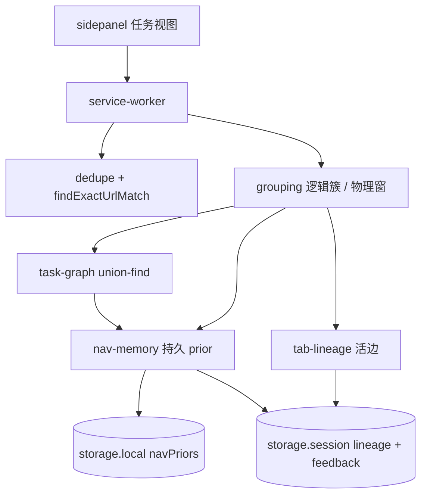

# 任务导航图 + 跨窗口 — 架构

## 0. 版本历史

| 版本 | 日期 | 变更 | 原因 |
|------|------|------|------|
| v0.1 | 2026-11-03 | 任务导航图 / navigation graph learning | 用户要求可学习来源 + 跨窗口 |
| v0.2 | 2026-11-03 | 项目亲和 + 短摘要 + 同窗同名物理组合一 | Bettr 过碎；两个「LinkE」 |

## 1. 命名

本增量的核心算法与数据面统一称为：

- **中文：任务导航图**
- **英文：session/task navigation graph learning**

它是一棵（或多棵）**标签树 + 弱先验图**，不是内容 embedding 聚类。

## 2. 分层



| 模块 | 职责 |
|------|------|
| `shared/task-graph.js` | 纯函数：union-find 任务簇；会话 merge/split |
| `shared/project-affinity.js` | 产品 slug / 本地同源 / origin+两段 path；禁止裸域名 |
| `shared/tab-summary.js` | 短摘要：标题 + path/slug + 1–2 句；禁止落盘全文 |
| `shared/model-group-judge.js` | 规则之后的模型同组钩子（只读摘要） |
| `shared/physical-groups.js` | 同窗同名物理组合并；禁止第二个同标题组 |
| `shared/nav-priors.js` | 纯函数：prior 加减权、封顶、拒绝浅模式 |
| `shared/url-pattern.js` | origin+path，id/工单段 → `*`；禁止 hostname-only |
| `shared/dedupe-match.js` | 全量 tab 列表上的精确 URL 匹配 |
| `background/tab-lineage.js` | 存活期 opener / createdAt / referrer / 跨窗 attached |
| `background/nav-memory.js` | 关闭时落 prior；`applyTaskFeedback` 扩展点 |
| `background/grouping.js` | 抽正文、打主题名、建图、按窗 `tabGroups` |
| `background/dedupe.js` | `tabs.query({})` 后跳到已有窗口+标签 |

## 3. 数据

### 3.1 活边（`chrome.storage.session` `tabLineage`）

```text
tabId → { openerTabId, openerUrl, createdAt, windowId, url, pendingUrl, referrerUrl }
```

`createdAt === 0` 表示未观察到 `onCreated`（SW 冷启动补种），**不参与时间边**，避免把所有旧标签误并。

### 3.2 持久 prior（`chrome.storage.local` `navPriors`）

```text
{
  version: 1,
  pairs: {
    "https://linear.app/acme/issue/*||https://docs.acme.dev/oncall/runbook": {
      weight, count, lastSeen,
      sources: { opener, time, feedback }
    }
  }
}
```

写入规则：

- 两侧模式都必须非浅（不是裸 origin / `/*`）。
- 两侧模式不能相同（避免「同仓库所有 issue 互相关联」≈ 变相域名/路径聚合）。
- 关闭标签时：opener 对 `+0.2`，同窗时间相邻对 `+0.05`。
- 用户合并 `+0.35`，拆分 `-0.5`。
- 容量 2000，按 `lastSeen` 淘汰。

### 3.3 会话反馈（`taskFeedbackEdges`）

`merges: [tabId, tabId][]`、`splits: [tabId, tabId][]`。  
拆分覆盖 opener（用户明确说「不是同一任务」）；合并强制连边。这是后续加厚在线学习的稳定扩展点：`applyTaskFeedback` / `MSG.TASK_FEEDBACK`。

### 3.4 短摘要（`chrome.storage.session` `tabSummaries`）

```text
tabId → { title, url, pathKey, slugs[], excerpt≤280, extractedAt }
```

导航换 URL 即刷新（丢掉旧摘录）；关标签删除。容量 200。抽取最多读 ~800 字进内存，只留下 1–2 句。**禁止**把 4k 正文写入任何 storage。

## 4. 聚类（union-find）

顺序：会话合并 → opener → referrer 命中 → **项目亲和**（标题不拆）→ 时间（主题兼容）→ 学习 prior（权重 ≥ 0.35 且主题兼容）→ 语义只拆「没有强边、主题混杂」的弱簇 → 可选模型同组（只看短摘要，只加并、不拆强边）。

**禁止**：用裸 hostname 或「仅 label 相同」做并查集 union。同窗**物理组**则按规范化标题合一：不得出现两个「LinkE」。

任务显示名 = `projectDisplayName`（如 Bettr Promotion）或簇内多数主题；混合 opener / 项目链保留整簇。

## 5. 物理 vs 逻辑

- 逻辑簇 `task-*` 可含多个 `windowId`。
- 物理：对每个 `(cluster, windowId)` 调用 `tabs.group`；**不** `tabs.move` 跨窗。
- 复用已有 group：同窗规范化标题相同则并入（并折叠重复同名组）；否则仅复用「只含本批标签」的组。**同一窗口不得创建第二个同标题 `tabGroup`。**

## 6. 去重

`handleExactDedupe` → `chrome.tabs.query({})` → `findExactUrlMatch`（更小 `tabId` 优先）→ `tabs.update` + `windows.update({focused:true})` → `tabs.remove`。  
失败则保留新标签。与任务图解耦。

## 7. 消息

| type | 作用 |
|------|------|
| `GET_TASK_VIEW` | `{ allWindows }` → 逻辑簇 + 窗口徽章 |
| `GROUP_TABS` | 抽取+建图+按窗物理整理 |
| `GROUP_CURRENT_WINDOW` | 兼容旧调用 |
| `TASK_FEEDBACK` | `{ action: merge\|split, tabIds, urlsA, urlsB }` |
| `TAB_NAV_HINT` | content script 上报 referrer |

## 8. 防腐化

1. 学习边不得退化为 hostname 对。
2. 去重不得依赖 LLM / 任务图。
3. 语义不得重新成为主聚类；也不得因标题冲突拆开项目亲和。
4. 物理组不得跨窗口移动标签；同窗不得出现两个同名组。
5. 自定义 Key 仍只放 `storage.sync`，不进仓库。
6. 不得把整页正文写入 storage；只持久化短摘要（标题 + path/slug + ≤280 字摘录）。
